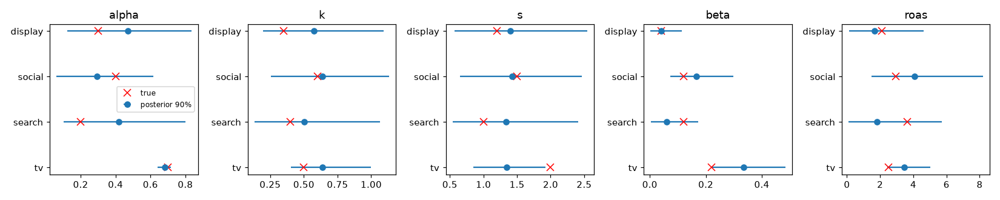
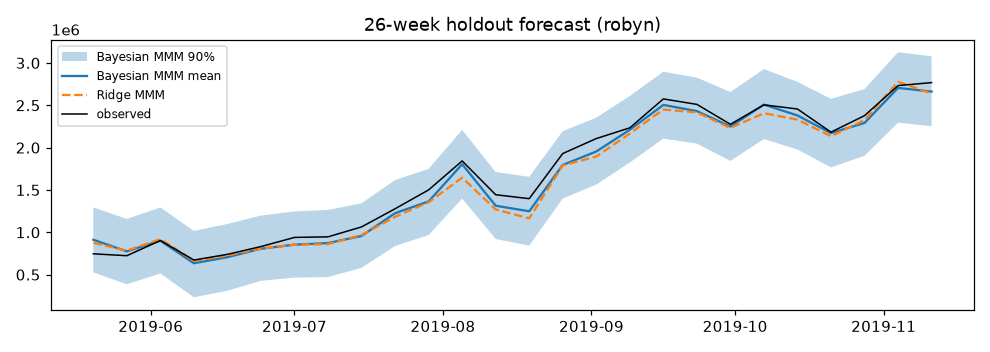
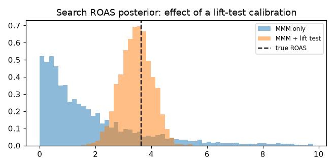
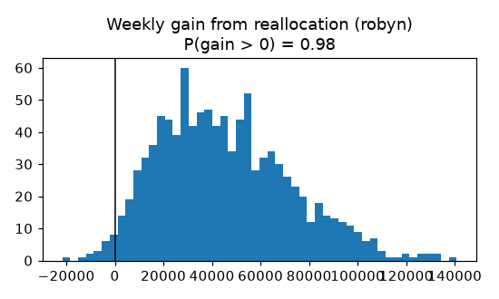
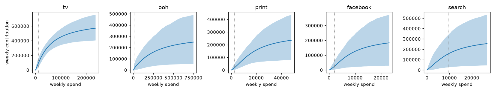

# Bayesian Marketing Mix Model

How much revenue does each ad channel really bring in, and how should the budget move? This repo answers both with a Bayesian MMM written in PyMC. Every return-on-ad-spend (ROAS) figure comes with a credible interval, and every budget recommendation comes with the probability that it actually helps.

It complements my [causal incrementality project](https://github.com/waelsabri11/Budget-Allocation-Optimization) (stacked difference-in-differences on coupon campaigns). That project measures one intervention with an experiment-style design. This one models all channels together from observational weekly data, and section 3 shows how an experiment's result feeds back into the model as calibration.

```bash
uv sync
uv run mmm-run                            # whole pipeline, ~2.5 min on a laptop CPU, writes results/
uv run pytest                             # 9 tests
uv run streamlit run app/streamlit_app.py # budget scenario simulator
```

## Results

All numbers below come from `results/metrics.json` and the CSVs next to it, produced by `uv run mmm-run` (seed 42). Intervals are 90% equal-tailed credible intervals.

### 1. Parameter recovery on simulated data with known truth

I simulated 208 weeks with four channels (TV in flights, always-on search that follows seasonality, social, and display bought alongside social with correlation 0.69), plus trend, yearly seasonality, a promo flag, a price index and noise. Then I fit the model and checked whether the posterior intervals contain the true values.

| | adstock α | half-sat. k | shape s | max effect β | ROAS |
|---|---|---|---|---|---|
| True value inside 90% interval | 4/4 | 4/4 | 3/4 | 3/4 | **4/4** |

**Overall: 18/20 true values are inside the 90% intervals.** Both misses are on TV: the model trades a softer saturation shape (s: true 2.0, interval 0.85–1.93) for a higher ceiling (β: true 0.22, interval 0.221–0.484). TV's ROAS, the quantity a decision uses, is still covered.

| Channel | True ROAS | Bayesian MMM: mean [90% CI] | Ridge MMM (point) |
|---|---|---|---|
| TV | 2.51 | 3.44 [2.45, 5.02] | 5.11 |
| Search | 3.63 | 1.83 [0.10, 5.70] | **−5.69** |
| Social | 2.94 | 4.08 [1.46, 8.22] | 6.13 |
| Display | 2.12 | 1.67 [0.11, 4.63] | **−0.97** |

The Bayesian intervals are wide, and they should be: 208 weeks of observational data cannot pin down search, which moves with seasonality, or display, which moves with social. The mean absolute error of the ROAS posterior means is 1.08. The Ridge baseline answers the same question with confident point estimates, two of which are negative ROAS. A negative ROAS is impossible here by construction.



### 2. Holdout forecast (last 26 weeks held out, model refit on the first 182)

| Dataset | Bayesian MMM MAPE | Ridge MMM MAPE | Bayesian 90% interval coverage |
|---|---|---|---|
| Simulated | **2.40%** | 2.75% | 92% (24/26 weeks) |
| Robyn demo | **5.36%** | 6.46% | 100% (26/26 weeks) |

The Ridge baseline is a reasonably tuned Robyn-style model: per-channel adstock and saturation hyperparameters plus the Ridge penalty are chosen by 300-draw random search with time-series cross-validation. On Robyn, 26/26 coverage suggests the predictive intervals are, if anything, a bit conservative.



### 3. Calibrating with a lift test

Search is the weakest channel in the simulated study because its spend follows demand seasonality. I simulated a 4-week "go dark" geo test (search spend from its average down to 0; measured lift drawn from the true effect with a 15% standard error) and added it to the model as an extra likelihood term on search's response curve.

| Search ROAS (true 3.63) | Mean | 90% CI | CI width |
|---|---|---|---|
| MMM only | 1.83 | [0.10, 5.70] | 5.60 |
| MMM + one lift test | **3.46** | **[2.55, 4.35]** | 1.80 (−68%) |



### 4. Budget reallocation under uncertainty

The total weekly budget stays fixed at the last-52-week average. Each channel can move within ±50% of its current spend, so the recommendation stays near the data the curves were learned from. I maximise the posterior-expected media contribution and then score the move across all posterior draws.

**Simulated (calibrated model), where the true curves are known:**
- Predicted gain: +13.5k/week (+4.4% of media-driven revenue), 90% CI [−1.8k, +26.0k], **P(improvement) = 0.94**.
- Gain measured on the *true* response curves: **+11.9k/week**. The best possible reallocation under the true curves, with the same budget and bounds, gains +12.2k, so the recommendation captures **97% of the attainable gain**.
- The move: TV +35%, display −50%, search −39%, social +5%.

**Robyn demo data:**
- Predicted gain: **+45.2k/week (+14.6% of media-driven revenue), 90% CI [+7.2k, +94.9k], P(improvement) = 0.98**.
- The move: OOH −50%, TV −13%, search +37%, print +50%, Facebook +50%. Four of the five channels end up on a ±50% bound, so the model clearly wants to go further than I let it. The size of that gain depends on the bounds, and the honest next step would be a lift test on OOH or Facebook rather than a bigger move.



### 5. Robyn demo dataset: channel ROAS

Meta's Robyn demo data: 208 weeks of revenue, five paid channels, plus competitor sales, newsletter and event controls.

| Channel | Spend share | Contribution share | ROAS mean [90% CI] | P(ROAS > 1) | Ridge ROAS |
|---|---|---|---|---|---|
| TV | 21% | 5.3% | 6.5 [4.3, 9.2] | 1.00 | 5.3 |
| OOH | 62% | 2.2% | 0.9 [0.1, 2.3] | 0.37 | 1.8 |
| Print | 5% | 1.7% | 8.2 [2.5, 15.3] | 0.99 | 11.4 |
| Facebook | 3% | 1.5% | 13.0 [2.2, 26.5] | 0.98 | 3.9 |
| Search | 8% | 5.4% | 16.7 [2.6, 38.9] | 0.98 | 9.7 |

The story is clear even with wide intervals: OOH takes 62% of spend and is the only channel that probably does not pay back. The small digital channels have high but very uncertain returns.



### Diagnostics

| Fit | max R-hat | min bulk ESS | divergences | time |
|---|---|---|---|---|
| Simulated, full | 1.003 | 1,859 | 3 / 4,000 | 42 s |
| Simulated, calibrated | 1.004 | 1,649 | 0 | |
| Simulated, holdout | 1.004 | 1,725 | 0 | |
| Robyn, full | 1.006 | 2,376 | 0 | 15 s |
| Robyn, holdout | 1.002 | 2,589 | 0 | |

The three divergences in the simulated fit sit in a corner of the posterior where search, a channel the data cannot identify, gets a very small half-saturation point and a steep Hill shape. Raising `target_accept` from 0.9 to 0.99 (with 1,500 tuning steps) brought them down from 30 to 3. A reparameterisation (see Limits) would probably remove them entirely.

Prior predictive checks: 100% (simulated) and 99% (Robyn) of observed weeks fall inside the prior 90% band, which is about 1.9× average sales wide. The priors are weakly informative and do not decide the answer. Posterior predictive in-sample: MAPE 2.7% / 6.0%, 90% coverage 91% / 96% (simulated / Robyn).

Plots for every check are in `results/figures/` (prior and posterior predictive, traces, holdout, response curves).

## Method

**Model** (`src/mmm/model.py`). Sales are scaled by their training mean, each channel's spend by its peak week, and controls are standardised.

```
sales_t = intercept + trend·t + Fourier(t, order 2) + controls_t·γ
          + Σ_c β_c · Hill(Adstock(spend_c)_t ; k_c, s_c) + ε_t
Adstock: normalised geometric, weights α^l / Σα^l over 8 weeks (a constant spend x stays x at steady state)
Hill(x; k, s) = x^s / (x^s + k^s)
```

| Prior | Choice | Reason |
|---|---|---|
| α ~ Beta(2, 2) | decay, mean 0.5 | anything from no carry-over to long TV memory |
| k ~ Gamma(μ 0.5, σ 0.25) | half-saturation, in units of peak weekly spend | saturation somewhere inside the observed range |
| s ~ Gamma(μ 1.5, σ 0.6) | Hill shape | allows concave (s ≤ 1) and S-shaped curves |
| β ~ HalfNormal(0.3) | max weekly effect / average sales | positive, and a single channel rarely exceeds ~60% of sales |
| intercept ~ N(0.6, 0.3), trend ~ N(0, 0.3), Fourier/controls ~ N(0, 0.2), σ ~ HalfNormal(0.1) | | weakly informative on the scaled outcome |

**Inference.** NUTS with 4 chains × 1,000 draws (1,500 tuning steps), `target_accept=0.99`, seed 42.

**ROAS** is modelled contribution divided by spend over the same weeks, computed per posterior draw. **Response curves** are steady-state: a constant weekly spend x gives β·Hill(x/peak) per week.

**Lift-test calibration.** A test that moves weekly spend from x₀ to x₁ for w weeks and measures a total lift L ± se adds the term `L ~ Normal(w·β·[Hill(x₁) − Hill(x₀)], se)`. That is how an experiment becomes an informative prior on the channel's curve, and it is the same idea PyMC-Marketing and Meridian use.

**Budget optimisation** (`src/mmm/optimize.py`). SLSQP maximises the mean across 1,000 posterior draws of total steady-state contribution, with the budget held fixed and per-channel bounds. The gain distribution over draws gives the interval and P(improvement).

## Design choices

- **Plain PyMC instead of PyMC-Marketing.** PyMC-Marketing ships adstock, saturation, lift-test calibration and a budget optimiser, and I would use it in production. Writing the model directly (one ~150-line module) made every prior, the scaling, and the calibration likelihood explicit and testable. It also kept the dependency set small. The transforms and the calibration term follow the same conventions, so moving to PyMC-Marketing would be straightforward.
- **A simulator first.** On real MMM data nobody knows the true ROAS, so a model that fits sales well can still be wrong about channels. The simulator is the only place to check that the intervals mean something, and the confounded search channel and correlated display channel are there on purpose.
- **Runs locally on CPU, no cloud.** Five NUTS fits on 208 weeks take about 2.5 minutes on a laptop (Apple Silicon, 4 chains in parallel). Cloud compute or a GPU would add cost and setup for no benefit at this size. A geo-level hierarchical model with hundreds of series would be the point to reach for JAX/NumPyro or a bigger machine.
- **Reproducible.** Seeds are fixed everywhere, `uv.lock` pins every dependency, and the Robyn data is downloaded by the pipeline (MIT licence, not committed). The Streamlit app reads 500 saved posterior draws (`results/robyn_posterior_params.npz`, 80 KB), so it needs no refit.

## Limits

- **The Robyn demo data is itself synthetic** (Meta's `dt_simulated_weekly`), but its true parameters are not published. So the Robyn results show the workflow on realistic data, not validated truths.
- **Weak identifiability is real.** With about 200 weekly observations, saturation shape and maximum effect trade off against each other (the TV misses), and channels that co-move with seasonality or with each other get wide ROAS intervals. The model reports this instead of hiding it, but the cure is experiments (section 3), not more modelling.
- **Steady-state response curves** treat spend as constant week to week. TV in the simulation is bought in flights, so the curve describes an always-on equivalent.
- **The optimiser trusts the curves only within ±50% of current spend.** On Robyn it hits those bounds, so the +14.6% is a "move in this direction" result, not a forecast of the optimum.
- **Not included:** a hierarchical geo-level variant (both datasets are national), time-varying coefficients, and a reparameterisation of β and k that would remove the remaining divergences.

## Layout

```
src/mmm/transforms.py   adstock, Hill, Fourier (NumPy + PyTensor)
src/mmm/simulate.py     simulated data with known truth
src/mmm/data.py         Robyn download and loading
src/mmm/model.py        PyMC model, lift-test calibration, ROAS, response curves, diagnostics
src/mmm/baseline.py     Ridge MMM baseline with time-series CV
src/mmm/optimize.py     budget optimisation and scenarios under uncertainty
src/mmm/pipeline.py     end-to-end run -> results/
app/streamlit_app.py    budget scenario simulator
tests/                  9 pytest tests
```

Data: [Robyn](https://github.com/facebookexperimental/Robyn) demo dataset © Meta Platforms, MIT licence.
